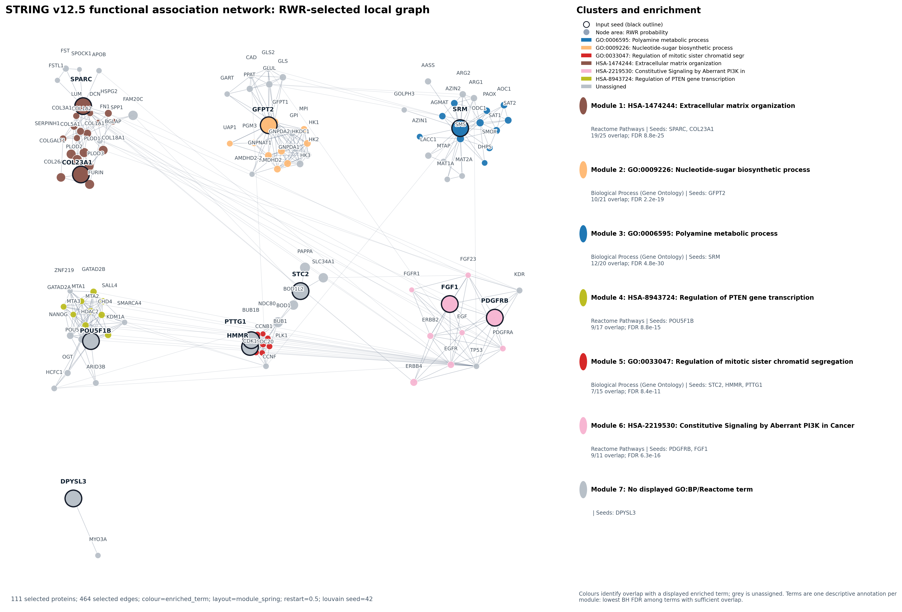

# RWR: a notebook-first STRING network workflow

**A reproducible notebook workflow for biomedical network-proximity analysis, candidate-gene prioritization, and descriptive pathway annotation.** It is for biomedical research and hypothesis generation—not clinical decision support, diagnosis, causal-mechanism inference, target validation, or treatment prediction.

RWR is a public Python tutorial for asking a focused network-proximity question from a gene list. It maps and validates gene symbols against a versioned STRING release, performs weighted random walk with restart (RWR), selects a local network around the seeds, identifies graph communities, annotates those communities with supplied GO:BP/Reactome-style gene sets, and plots the selected local graph.

The worked example uses STRING v12.5. Functional and physical association networks are analysed independently: they are different graph inputs, not two layers to merge.



## Start here: the primary Jupyter tutorial

[`vignettes/01_string_rwr_workflow.ipynb`](vignettes/01_string_rwr_workflow.ipynb) is the primary workflow. It starts with an ordinary list of gene symbols, creates and audits the STRING seed table inside Jupyter, and performs the analysis and plotting step by step.

The rendered read-only version is [`vignettes/01_string_rwr_workflow.html`](vignettes/01_string_rwr_workflow.html).

## Expected directory layout

Run commands from the `RWR/` directory (or from the repository root if you publish the contents of this directory as the repository):

```text
RWR/
├── assets/                         # README example figure
├── data/
│   ├── string_worked_example_seeds.tsv
│   └── 9606.protein.*.v12.5.txt.gz # created by download_string_data.py
├── provenance/
│   └── string_v12_5_source_manifest.json
├── src/
├── tests/
├── vignettes/
│   └── 01_string_rwr_workflow.ipynb
├── download_string_data.py
├── requirements.txt
└── README.md
```

The four `.gz` archives are intentionally not committed. They must be obtained through the downloader so the release and checksums used in the analysis are recorded and verified.

## Reproduce the worked analysis

From `RWR/`:

```bash
python -m venv .venv
.venv/bin/python -m pip install -r requirements.txt
.venv/bin/python download_string_data.py
.venv/bin/jupyter nbconvert --to notebook --execute --inplace \
  --ExecutePreprocessor.timeout=300 vignettes/01_string_rwr_workflow.ipynb
```

Do not skip the downloader: it reads the checked-in source manifest, obtains the official versioned STRING archives, and verifies SHA-256 checksums before the notebook runs. The notebook writes fresh output to `results/notebook_run/` and `results/notebook_physical_run/`.

RWR probability is network proximity to the seed distribution. It is not target confidence, biological effect direction, pathway activity, inhibition, mutation, biochemical flux, or causal evidence.

## Optional automation

[`vignettes/02_optional_cli_runner.ipynb`](vignettes/02_optional_cli_runner.ipynb) documents an optional command-line route for unattended or batch runs. It is intentionally secondary to the notebook.

The reusable code lives in `src/public_workflow.py`. It supports a custom edge table with `source`, `target`, and optional non-negative `weight`; document whether the graph is directed and ensure graph nodes, seed IDs, and GMT identifiers share the same ID system.

For clean-environment verification, including Leiden dependencies and test execution, see [`../INSTALLME.md`](../INSTALLME.md).
